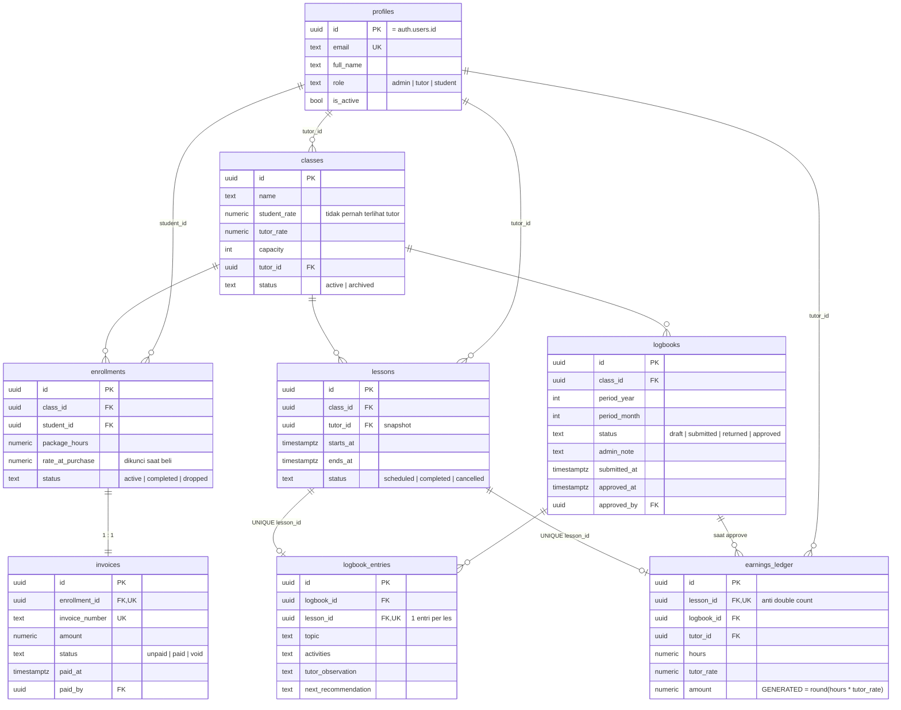
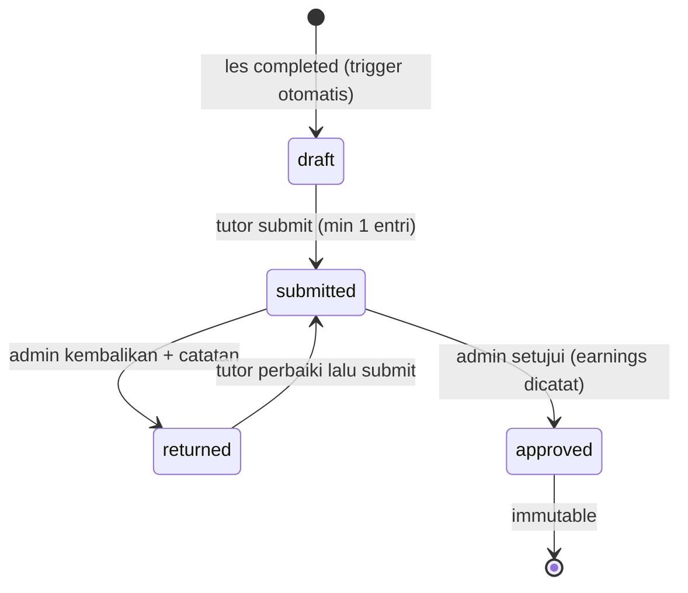

# Arsitektur

Dokumen ini menjelaskan bagaimana aplikasi disusun dan, yang lebih penting,
**kenapa** setiap aturan diletakkan di tempatnya. Kalau kamu hanya punya waktu
membaca satu bagian, baca bagian 3.

---

## 1. Bentuk sistem

```
┌─────────────────────────────────────────────────────────────────────┐
│ Browser                                                             │
│   Server-rendered HTML + sedikit Client Component (form, login)      │
└───────────────────────────────┬─────────────────────────────────────┘
                                │ HTTP (cookie sesi Supabase)
┌───────────────────────────────▼─────────────────────────────────────┐
│ Next.js 15 (App Router)                                             │
│                                                                     │
│   middleware.ts      refresh token + header keamanan                │
│   Server Component   ambil profil, query, render                    │
│   Server Action      validasi input, tulis, revalidatePath          │
└───────────────────────────────┬─────────────────────────────────────┘
                                │ HTTPS + JWT user (bukan service role)
┌───────────────────────────────▼─────────────────────────────────────┐
│ Supabase                                                            │
│                                                                     │
│   GoTrue        auth.users, password grant                          │
│   PostgREST     REST API, otomatis tunduk pada RLS                  │
│   PostgreSQL    schema, trigger, constraint, view, policy           │
└─────────────────────────────────────────────────────────────────────┘
```

Tidak ada backend terpisah. Next.js memegang sesi user dan memakai anon key,
bukan service role key. Artinya setiap query dari aplikasi tetap melewati RLS
persis seperti query `curl` dari luar. Itu bukan kebetulan, itu tujuannya: tidak
ada jalur istimewa yang perlu diaudit terpisah.

---

## 2. Model data



Tiga kolom yang menanggung beban desain:

- `enrollments.rate_at_purchase` — snapshot harga. Mengubah rate kelas tidak
  pernah menulis ulang invoice yang sudah terbit.
- `lessons.tutor_id` — snapshot tutor. Diperlukan oleh EXCLUDE constraint
  anti-overlap, dan membuat re-assign tutor hanya berlaku untuk les yang belum
  terjadi.
- `earnings_ledger.amount` — kolom generated. Jam dan rate tidak bisa berselisih
  dengan nominal yang dibayarkan, karena nominalnya dihitung database.

### View

| View | Isi | Dipakai di |
|---|---|---|
| `v_classes_safe` | kelas tanpa `student_rate` untuk tutor | semua halaman kelas |
| `v_enrollment_balance` | `hours_used` dan `hours_remaining` per enrollment | beranda siswa, detail kelas |
| `v_class_finance` | `revenue_paid`, `tutor_cost_approved`, `margin` per kelas | belum dipakai UI (lihat DECISIONS) |
| `v_logbook_summary` | jumlah entri, total jam, `projected_payout` vs `ledgered_payout` | halaman review admin |

`v_classes_safe` memakai `security_invoker = true` supaya RLS tabel `classes`
tetap berlaku, dan mem-mask `student_rate` dengan
`case when auth_is_admin() or auth_student_has_paid(id) then student_rate end`.
Untuk tutor hasilnya `null` — dari database, bukan dari CSS.

---

## 3. Di mana setiap aturan ditegakkan

Ini inti desainnya. Urutan pertahanan: **constraint > trigger > RLS > aplikasi**.
Aplikasi adalah lapisan paling lemah, jadi tidak ada aturan bisnis yang
mengandalkan aplikasi saja.

| Aturan | Tempat | Mekanisme |
|---|---|---|
| Satu enrollment aktif per siswa per kelas | `db/01_schema.sql` | partial unique index `enrollments_one_active_per_student` |
| Kapasitas kelas tidak terlampaui | `db/02_triggers.sql` | `fn_enrollments_check_capacity`, `SELECT ... FOR UPDATE` pada baris kelas |
| Kelas arsip tidak menerima siswa baru | trigger yang sama | cek `classes.status` |
| Invoice dibuat otomatis, nominal dari server | `db/02_triggers.sql` | `fn_enrollments_create_invoice`, `amount = package_hours x rate_at_purchase` |
| `ends_at > starts_at`, maksimum 8 jam | `db/01_schema.sql` | CHECK `lessons_time_order`, `lessons_max_duration` |
| Tutor tidak bisa mengajar dua kelas bersamaan | `db/01_schema.sql` | EXCLUDE `lessons_no_tutor_overlap` pada `tstzrange`, `WHERE status <> 'cancelled'` |
| Satu logbook per kelas per bulan | `db/01_schema.sql` | `unique (class_id, period_year, period_month)` |
| Satu entri per les | `db/01_schema.sql` | `unique (lesson_id)` |
| Entri hanya untuk les berstatus completed | `db/02_triggers.sql` | `fn_logbook_entries_guard` |
| Entri hanya di dalam periode bulan logbook (WIB) | trigger yang sama | bandingkan `starts_at` dengan `make_timestamptz(..., 'Asia/Jakarta')` |
| Entri tidak boleh melebihi sisa jam siswa | trigger yang sama | cek `v_enrollment_balance.hours_remaining` semua siswa lunas |
| Transisi logbook hanya draft/returned -> submitted -> approved | `db/02_triggers.sql` | `fn_logbooks_guard_transition` |
| Submit/approve butuh minimal satu entri | trigger yang sama | hitung `logbook_entries` |
| Returned wajib punya catatan | `db/01_schema.sql` | CHECK `logbooks_returned_needs_note` |
| Approved immutable | `db/02_triggers.sql` | `fn_logbooks_block_mutation`, `fn_logbook_entries_block_mutation` |
| Entri terkunci sejak submitted | `fn_logbook_entries_block_mutation` | cek status `submitted` juga, bukan hanya `approved` |
| Earnings sekali per les | `db/01_schema.sql` + trigger | UNIQUE + `on conflict (lesson_id) do nothing` |
| Les yang sudah punya entri tidak bisa dibatalkan | `db/02_triggers.sql` | `fn_lessons_block_cancel_logged` |
| Paid invoice tidak bisa di-undo setelah jam terpakai | `db/02_triggers.sql` | `fn_invoices_guard` + `v_enrollment_balance.hours_used` |
| Paid invoice harus mencatat kapan dan oleh siapa | `db/01_schema.sql` | CHECK `invoices_paid_consistency` |
| Siswa tidak melihat kelas/logbook yang belum lunas | `db/03_rls.sql` | policy + `auth_student_has_paid` |
| Tutor tidak melihat `student_rate` | `db/03_rls.sql` | view masking `v_classes_safe` |
| Tutor tidak melihat kelas tutor lain | `db/03_rls.sql` | `classes_select_tutor` memakai `auth_tutor_teaches(id)` |
| Logbook hanya terlihat siswa setelah approved | `db/03_rls.sql` | `logbooks_select_student_approved`, `logbook_entries_select_student_approved` |
| Hanya admin yang menandai invoice lunas | `db/03_rls.sql` | `invoices_update_admin` |
| Klien tidak bisa mendaftarkan diri sebagai admin | `db/06_auth_sync.sql` | `fn_handle_new_user` clamp ke `tutor`/`student` |

### Konsekuensi yang perlu diketahui

- Karena `fn_logbooks_generate_earnings` melakukan insert ke `earnings_ledger`
  atas nama admin yang menyetujui, fungsi itu `SECURITY DEFINER`. Tanpa itu
  insert ditolak RLS (tidak ada policy INSERT untuk admin di ledger), dan
  approval gagal. Ledger jadi bisa ditulis hanya lewat jalur ini.
- Handler RLS (`auth_role`, `auth_is_admin`, `auth_student_has_paid`, dst.)
  juga `SECURITY DEFINER`, karena kalau tidak, policy `profiles` akan rekursif
  ke dirinya sendiri saat membaca role.
- `approved_by` diisi dengan `coalesce(auth.uid(), new.approved_by)`. Di luar
  konteks JWT (psql, seed, test) `auth.uid()` bernilai null; assignment langsung
  akan menimpa nilai yang dikirim pemanggil dan melanggar CHECK. Di jalur API
  `auth.uid()` selalu ada, jadi tetap menang atas apa pun yang diklaim klien.

---

## 4. Alur utama

### 4.1 Enrollment sampai pembayaran

```
Admin pilih siswa + paket jam
        │
        ▼
INSERT enrollments (rate_at_purchase diambil dari classes, bukan dari form)
        │
        ├─► BEFORE INSERT  fn_enrollments_check_capacity
        │     lock kelas, hitung enrollment aktif, tolak kalau penuh/arsip
        │
        └─► AFTER INSERT   fn_enrollments_create_invoice
              buat invoices: nomor INV-YYYYMM-NNNN, amount = jam x rate
        │
        ▼
Admin klik "Tandai lunas"
        │
        └─► BEFORE UPDATE  fn_invoices_guard
              set paid_at = now(); status void tidak bisa diubah
        │
        ▼
RLS mulai membuka akses untuk siswa tersebut
```

Aplikasi tidak pernah mengirim `amount`. Kalau browser memalsukan rate, yang
tersimpan tetap rate dari tabel `classes` pada saat insert.

### 4.2 Les sampai earnings

```
Admin jadwalkan les
        │
        ├─► EXCLUDE lessons_no_tutor_overlap menolak jam yang bertabrakan
        ▼
Tutor klik "Tandai selesai"
        │
        ├─► fn_lessons_block_cancel_logged (kalau ternyata dibatalkan)
        └─► fn_lessons_open_logbook
              buat logbooks (class, tahun, bulan WIB) status draft, idempoten
        │
        ▼
Tutor isi entri
        │
        └─► fn_logbook_entries_guard
              les harus completed, kelas harus sama,
              tanggal harus di dalam periode, sisa jam semua siswa lunas harus cukup
        │
        ▼
Tutor submit
        │
        └─► fn_logbooks_guard_transition
              minimal 1 entri, set submitted_at, kosongkan admin_note
        │
        ▼
Admin review (v_logbook_summary: projected_payout vs ledgered_payout)
        │
        ├── kembalikan (status returned + admin_note wajib)
        │     tutor edit lagi, lalu submit ulang
        │
        └── setujui (status approved, approved_at, approved_by)
              │
              └─► fn_logbooks_generate_earnings  (SECURITY DEFINER, AFTER UPDATE)
                    insert earnings_ledger per les, on conflict (lesson_id) do nothing
                    amount dihitung sebagai kolom generated
        │
        ▼
Tutor lihat /tutor/pendapatan  (SUM earnings_ledger milik sendiri, RLS)
```

Klik setujui dua kali bukan "dicegah di kode aplikasi" — yang kedua menyentuh
`fn_logbooks_guard_transition` dan ditolak karena `old.status` sudah `approved`.

### 4.3 Siklus status logbook



`returned` bukan jalan pintas kembali ke `draft`: tutor mengedit di status
`returned`, lalu submit lagi. Tidak ada transisi lain yang diizinkan, dan
`approved` adalah terminal.

---

## 5. Lapisan aplikasi

### Sesi

`lib/session.ts` adalah satu-satunya tempat yang memutuskan "boleh masuk atau
tidak":

- `ambilProfilSekarang()` — `getClaims()` lalu baca `profiles`
- `wajibLogin()` — redirect `/login` kalau null
- `wajibPeran('admin' | 'tutor' | 'student')` — redirect `/tidak-berhak` kalau
  role tidak cocok
- `berandaUntuk(role)` — satu sumber kebenaran pemetaan role ke beranda

Setiap halaman memanggil `wajibPeran` di baris pertama. Ini penjagaan UX, bukan
penjagaan data: yang mencegah kebocoran tetap RLS.

### Client Supabase

Dua client, karena browser dan server menyimpan sesi dengan cara berbeda:

- `lib/supabase/server.ts` — membaca cookie dari request; `setAll` dibungkus
  try/catch karena Server Component tidak boleh menulis cookie (middleware yang
  menyegarkan sesi)
- `lib/supabase/browser.ts` — untuk Client Component

Catatan: saat ini seluruh query berjalan di server, jadi `lib/supabase/browser.ts`
belum dipakai di halaman mana pun. File itu dipertahankan karena login dan
seluruh form sudah Client Component; begitu ada kebutuhan query langsung dari
browser (realtime, upload), polanya sudah ada dan tidak perlu ditemukan ulang.

`middleware.ts` memanggil `supabase.auth.getUser()` di setiap request supaya
access token yang berumur 1 jam diperbarui sebelum halaman dirender. Tanpa itu
user terlihat logout padahal refresh token masih valid.

Halaman tidak memanggil `getUser()` lagi. `lib/session.ts` memakai
`getClaims()`, yang memverifikasi tanda tangan JWT secara lokal memakai WebCrypto
dan kunci publik yang di-cache. Project ini memakai signing key asimetris
(ES256, terlihat di `alg` pada JWT dan tersedia di
`/auth/v1/.well-known/jwks.json`), jadi verifikasinya tidak butuh round-trip.

Ini penting untuk kecepatan: satu `getUser()` adalah satu round-trip HTTP ke
Supabase Auth, dan jarak server aplikasi ke Supabase menentukan besarnya.
Dua panggilan per request (middleware + halaman) berarti dua round-trip yang
dibayar di setiap klik. Setelah halaman memakai `getClaims()`, sisa satu
round-trip saja, yaitu milik middleware — dan yang itu memang diperlukan untuk
refresh token.

Kalau suatu saat project pindah ke signing key simetris (HS256), `getClaims()`
otomatis kembali menjadi panggilan jaringan. Tidak ada yang perlu diubah, tapi
keuntungan latensinya hilang; itu konsekuensi yang perlu diketahui.

### Server Actions

Semua mutasi lewat Server Action (`app/admin/aksi.ts`, `app/tutor/aksi.ts`,
`app/aksi-auth.ts`), bukan API route:

- tidak perlu `fetch` dan parsing body
- `revalidatePath` menandai data yang terpengaruh sebagai basi. Penting:
  Server Action yang dipanggil sebagai fungsi biasa dari Client Component
  (pola di `FormAksi`) TIDAK otomatis mengirim ulang hasil render halaman.
  Karena itu `FormAksi` memanggil `router.refresh()` setelah sukses. Tanpa itu
  pesan sukses muncul tapi badge dan daftar masih versi lama, sehingga user
  merasa harus mengklik dua kali.
- error database diterjemahkan ke kalimat Indonesia di satu fungsi
  (`terjemahkanErrorDatabase`), dicocokkan lewat kata kunci

Karena Server Action menerima `FormData` dari klien, validasi di dalamnya hanya
lapisan kenyamanan. Aturan yang mengikat tetap yang ada di database.

`components/FormAksi.tsx` membungkus form + pesan error/sukses + state
"Memproses...". Ini satu-satunya Client Component yang dipakai berulang; sisanya
Server Component.

### Render

Setiap halaman mengikuti pola yang sama: ambil profil -> query -> render. Query
ditulis langsung di file halaman, tanpa layer repository. Alasannya praktis:
kalau ada angka yang salah, satu file cukup dibuka dan urutannya terbaca dari
atas ke bawah. Untuk aplikasi seukuran ini, layer tambahan hanya menambah
lompatan yang harus diikuti pembaca.

---

## 6. Keamanan

- APLIKASI memakai anon key. Service role key tidak pernah ada di repo, di
  image, atau di environment runtime.
- Header dari middleware: `X-Frame-Options: DENY`,
  `X-Content-Type-Options: nosniff`, `Referrer-Policy: strict-origin-when-cross-origin`.
- Image Docker jalan sebagai user `nextjs` (uid 1001), bukan root.
- Pesan login sengaja generik ("Email atau password salah") supaya tidak
  membocorkan apakah sebuah email terdaftar.
- Signup tidak tersedia di UI (PRD: hanya akun seed), tapi trigger
  `fn_handle_new_user` tetap membatasi role ke `tutor`/`student` kalau nanti
  signup diaktifkan.

---

## 7. Yang belum ada

Bagian ini jujur tentang batas implementasi, bukan daftar keinginan.

- `v_class_finance` (margin per kelas) sudah ada di database dan sudah diuji,
  tapi belum ditampilkan di UI.
- Billing health panel (siswa dengan sisa jam < 2, invoice unpaid > 7 hari),
  export CSV earnings, dan validasi jadwal real-time belum dikerjakan.
- Tutor bisa membuat les lewat RLS (`lessons_write_tutor`), tapi UI-nya hanya
  menyediakan penjadwalan dari sisi admin.
- Top-up paket belum punya alur yang benar. `enrollments_one_active_per_student`
  hanya mengizinkan satu enrollment aktif per siswa per kelas, jadi menambah
  paket kedua untuk siswa yang masih aktif akan ditolak. Alur yang bisa
  dijalankan sekarang: enrollment lama ditandai `completed`, lalu enrollment
  baru dibuat. Konsekuensinya siswa kehilangan akses selama invoice baru belum
  lunas, dan sisa jam paket lama tidak terbawa. Ini celah desain, bukan bug
  yang tidak disadari.
- Belum ada test otomatis untuk lapisan UI (komponen/halaman). Pengujian yang
  ada fokus pada aturan yang paling mahal kalau salah, yaitu database.