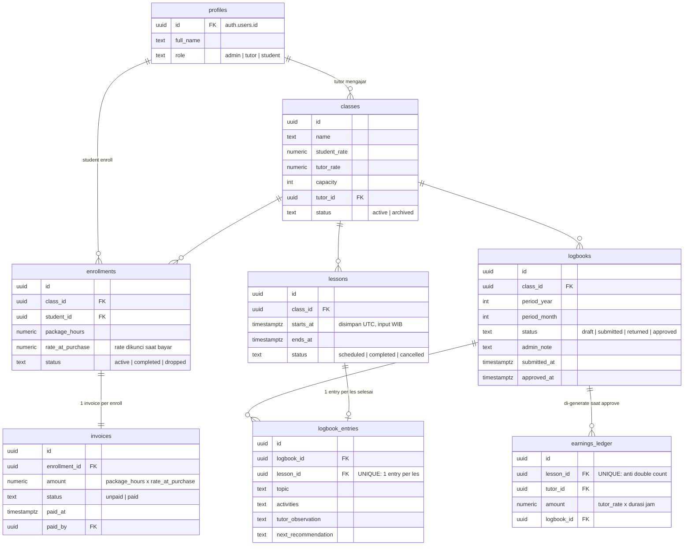

# PRD: Group Class Enrollment & Billing (Star Generation Take Home Test)

Status: Draft v1
Target: Full Stack Developer Take Home Test, PT. Generasi Bintang Cemerlang
Timebox: 1 hari kerja
Stack: TypeScript, Next.js (React), Tailwind CSS, Supabase (Auth + PostgreSQL), Git/GitHub

---

## 1. Latar Belakang & Masalah

Operasional kelas grup saat ini berjalan di spreadsheet + WhatsApp. Akibatnya:

- Admin tidak bisa melihat: sisa jam tiap siswa, invoice yang belum dibayar, profitabilitas kelas.
- Tutor harus menanyakan admin setiap bulan soal pembayaran mereka.
- Logbook les tidak terstruktur, sulit direview, dan tidak bisa dipercaya oleh orang tua/siswa.

Sistem yang dibutuhkan: satu aplikasi role-based (Admin, Tutor, Student) yang menyatukan enrollment, billing, penjadwalan les, logbook bulanan, dan perhitungan earnings tutor.

## 2. Tujuan & Non-Tujuan

### Tujuan (Scope In)
1. Tiga view berbasis role dengan akses data yang ketat (enforcement di level database, bukan hanya UI).
2. Alur lengkap: enroll → invoice → bayar → akses kelas → les → logbook → approval → earnings.
3. Semua aturan bisnis (kapasitas, overlap jadwal, jam paket, earnings sekali saja) di-enforce di PostgreSQL (constraint, trigger, RLS).
4. Seed data yang langsung mendemonstrasikan semua skenario: 1 admin, 2 tutor, 3 siswa, 1 kelas kapasitas 2.
5. Dokumentasi engineering: README, ARCHITECTURE, DECISIONS.

### Non-Tujuan (Scope Out)
- Payment gateway asli (pembayaran disimulasikan).
- Sign-up / registrasi mandiri (hanya seeded logins).
- Notifikasi email / WhatsApp otomatis.
- Mobile native app.
- Sistem multi-cabang / multi-tenant.

## 3. Peran & Persona

| Role | Persona | Kebutuhan inti |
|---|---|---|
| Admin | Pemilik operasional | Kontrol kelas, rate, invoice, approval logbook, visibility margin & profitabilitas |
| Tutor | Pengajar les | Jadwal les, isi logbook, lihat earnings sendiri (tanpa tahu rate siswa) |
| Student | Pelajar / orang tua | Lihat kelas yang sudah dibayar, jadwal, sisa jam, logbook yang sudah approved |

Aturan akses data (hard rule):
- Student hanya melihat kelas yang invoice-nya sudah Paid.
- Tutor hanya melihat kelas yang di-assign ke dia, dan tidak pernah melihat student rate.
- Logbook tersembunyi dari student sampai status Approved, termasuk di level API (RLS, bukan hanya hidden di UI).

## 4. Model Bisnis

- Siswa membeli **paket jam les** untuk satu kelas grup, contoh 12 jam, dengan harga per jam = student rate kelas pada saat pembelian.
- Tutor dibayar **tutor rate per jam** untuk setiap les yang diajar, terlepas dari jumlah siswa (1 les 90 menit dengan rate Rp100.000/jam = Rp150.000).
- **Margin kelas** = total yang dibayar siswa - total earnings tutor.
- Earnings tutor hanya dihitung dari les yang ada di **logbook bulanan yang sudah Approved**, tepat satu kali per les.

## 5. Model Data

Prinsip desain:
- `rate_at_purchase` disimpan di enrollments: perubahan rate kelas tidak mengubah invoice siswa yang sudah terlanjur.
- `earnings_ledger` adalah sumber kebenaran earnings. unique(lesson_id) membuat "approve ulang menambah earnings" secara struktural mustahil, bukan sekadar dicegah di kode aplikasi.
- Jam les disimpan timestamptz (UTC); UI mengonversi input/output ke WIB (UTC+7).

## 6. Enforcement Aturan Bisnis (Di Mana & Kenapa)

| Aturan | Enforced di | Kenapa di situ |
|---|---|---|
| Tidak ada enrollment ganda | UNIQUE(class_id, student_id) di enrollments | Database adalah garis pertahanan terakhir; UI bisa di-bypass |
| Kapasitas kelas tidak boleh dilewati | Trigger BEFORE INSERT pada enrollments (hitung enrollment aktif vs capacity) | Butuh query agregat saat transaksi; aman dari race condition dengan row lock |
| ends_at > starts_at | CHECK constraint di lessons | Murah, deklaratif |
| Jadwal tutor tidak overlap | EXCLUDE constraint: (tutor_id WITH =, tstzrange(starts_at, ends_at) WITH &&) WHERE status <> 'cancelled' | PostgreSQL punya constraint ini secara native; lebih kuat dari cek di aplikasi |
| Logbook 1 per kelas per bulan | UNIQUE(class_id, period_year, period_month) | Deklaratif |
| 1 entry per les | UNIQUE(lesson_id) di logbook_entries | Deklaratif |
| Approved logbook read-only | Trigger BEFORE UPDATE/DELETE pada logbooks + entries saat status = approved | Mutasi diblokir di database level |
| Earnings sekali per les | UNIQUE(lesson_id) di earnings_ledger + trigger hanya insert saat transisi ke approved | Idempoten by design; approve berulang = no-op |
| Student tidak lihat logbook belum approved | RLS SELECT policy: student hanya bisa SELECT logbooks/entries yang approved + enrollment-nya Paid | Karena Supabase API (PostgREST) otomatis mengikuti RLS, aturan ini ikut ter-enforce di API, bukan hanya UI |
| Tutor tidak lihat student rate | Kolom student_rate tidak pernah diselect untuk role tutor (view + RLS column privilege) | Bukan sekadar disembunyikan di UI |
| Invoice hanya admin yang bisa tandai Paid | RLS UPDATE policy: hanya role admin | Simulasi pembayaran, tetap butuh otorisasi jelas |

## 7. Kebutuhan Fungsional per Role

### 7.1 Admin
- CRUD kelas: nama, student rate, tutor rate, kapasitas, assign tutor.
- Dashboard: daftar siswa per kelas, sisa jam per siswa, status invoice, margin per kelas.
- Manajemen invoice: lihat semua invoice (unpaid/paid), tandai Paid (simulasi).
- Review logbook: lihat logbook yang disubmit tutor, preview total earnings tutor untuk logbook itu, lalu Approve atau Return (kirim balik dengan catatan).

Acceptance criteria:
- Saat approve, earnings ledger terbentuk tepat satu kali. Klik approve dua kali tidak menambah earnings.
- Margin kelas tampil: total pendapatan siswa - total earnings tutor.
- Admin bisa melihat logbook dalam semua status.

### 7.2 Tutor
- Melihat daftar kelas yang di-assign.
- Membuat/mengedit jadwal les (input waktu dalam WIB). Sistem menolak: end <= start, overlap dengan les lain milik tutor sama.
- Setelah les selesai (waktu end sudah lewat / ditandai completed), menambahkan entry logbook bulan tersebut: topic, activities, observation, recommendation.
- Finalisasi logbook bulan berjalan: kumpulkan semua entry, submit untuk approval.
- Melihat earnings: per les dan total (hanya dari logbook approved), tanpa pernah melihat student rate.

Acceptance criteria:
- Les yang overlap ditolak di UI dan di database.
- Entry logbook hanya untuk les yang sudah selesai.
- Setelah submitted, tutor tidak bisa mengedit sampai admin return.
- Total earnings tutor = SUM(earnings_ledger miliknya).

### 7.3 Student
- Melihat kelas yang diikutinya beserta status invoice.
- Setelah invoice Paid: melihat jadwal les kelas, logbook yang sudah approved, dan sisa jam paket.
- Tidak bisa melihat: kelas yang belum dibayar, logbook belum approved, rate tutor, data siswa lain.

Acceptance criteria:
- Sisa jam berkurang sesuai durasi les yang sudah completed dan tercatat di logbook.
- Akses via API langsung (curl dengan token student) tetap diblokir oleh RLS untuk data yang bukan haknya.

## 8. Keputusan Terbuka (Arah Awal, Final di DECISIONS.md)

| No | Keputusan | Arah awal (proposal) |
|---|---|---|
| 1 | Kalkulasi invoice & penghitungan jam terpakai | Invoice = package_hours x student_rate saat enroll (rate dikunci). Jam terpakai = durasi les berstatus completed yang sudah punya entry logbook. Sisa jam = package_hours - jam terpakai. |
| 2 | Efek perubahan rate/capacity/tutor ke siswa yang sudah bayar | Rate: siswa existing tidak terdampak (rate_at_purchase). Capacity: hanya berlaku untuk enrollment baru; tidak pernah menendang siswa aktif. Tutor: re-assign hanya memengaruhi les yang belum terjadi. |
| 3 | Siswa kehabisan jam / les dibatalkan | Jam habis: siswa tidak bisa di-schedule les baru melebihi sisa jam (dicek saat create lesson); admin bisa mengundang top-up paket baru (enrollment tambahan + invoice baru). Les dibatalkan: tidak mengurangi jam, tidak boleh punya logbook entry, dan tidak menghasilkan earnings. |
| 4 | Admin menemukan masalah di logbook yang disubmit | Status returned + admin_note wajib. Tutor mengedit entry lalu resubmit. Logbook yang sudah approved tidak bisa diedit; koreksi hanya lewat les baru/entry baru (immutable audit trail). |
| 5 | Bagaimana invoice jadi Paid, siapa yang boleh, bisa di-undo? | Hanya admin, tombol "Mark as Paid" (simulasi transfer). Undo diizinkan hanya jika belum ada jam terpakai dari paket tersebut (belum ada les completed), semua perubahan tercatat (paid_at, paid_by, audit log). Setelah jam terpakai, koreksi hanya lewat invoice adjustment baru. |

## 9. Improvement Kandidat (Pilih 2-3 Terbaik)

1. **Billing health panel untuk admin**: satu layar menampilkan siswa dengan jam < 2 jam (peringatan top-up), invoice unpaid > 7 hari, dan margin per kelas. Menyelesaikan masalah utama nomor 1 di brief ("admin cannot easily tell"). Ditinggalkan: laporan PDF otomatis (overkill untuk 1 hari).
2. **Tutor earnings statement**: rekap earnings per bulan per kelas yang bisa diekspor CSV, sehingga tutor tidak perlu menanyakan admin setiap bulan. Menyelesaikan masalah nomor 3 di brief. Ditinggalkan: PDF fancy, cukup CSV.
3. **Validasi jadwal real-time di form les**: sebelum submit, sistem cek overlap tutor & sisa jam siswa dan menampilkan pesan spesifik. Mengurangi friction input. Ditinggalkan: drag-and-drop calendar (biaya build tinggi, nilai rendah untuk test).

## 10. Desain & Theme

| Token | Nilai | Pakai untuk |
|---|---|---|
| Navy | #2F3F5F | Primary text, sidebar, primary buttons |
| Gold | #F1C019 | Accent, highlight, active state |
| Surface | #FAFDFF | Card & background |
| Cloud | #E0E2E7 / #6E7585 | Border / muted text |
| Success | #0AB848 | Paid, Approved |
| Destructive | #FF2819 | Error, destructive action |

- Font: DM Sans (Google Fonts), semua teks.
- Radius kartu: 6px.
- Struktur design system: satu file tokens (CSS variables / Tailwind theme extension) + komponen UI kecil (Button, Card, Badge, Table, Modal) yang dipakai konsisten di 3 role view.

## 11. Rencana Eksekusi 1 Hari

| Waktu | Pekerjaan |
|---|---|
| 0:00 - 1:00 | Repo init, Next.js + Supabase setup, schema SQL + seed SQL (commit 1-2) |
| 1:00 - 2:30 | RLS policies + trigger (kapasitas, overlap, ledger idempoten) (commit 3) |
| 2:30 - 4:00 | Auth + 3 role layout + navigasi; Admin: kelas + invoice (commit 4-5) |
| 4:00 - 5:30 | Tutor: jadwal + logbook + submit; Student: akses pasca bayar + sisa jam (commit 6-7) |
| 5:30 - 6:30 | Approval flow + earnings + billing health panel (commit 8) |
| 6:30 - 7:30 | README, ARCHITECTURE.md (diagram + keputusan enforcement), DECISIONS.md (commit 9) |
| 7:30 - 8:00 | QA manual semua acceptance criteria, polish, commit final |

Commit dilakukan progresif setiap potongan selesai, karena reviewer membaca history.

## 12. Definisi Selesai (Definition of Done)

1. Semua skenario seed bisa didemokan end-to-end tanpa error.
2. Semua aturan di tabel section 6 tervalidasi (termasuk uji negatif: coba enroll ganda via API, coba overlap, coba approve dua kali).
3. Build produksi berjalan tanpa error; README bisa diikuti dari fresh clone.
4. Ketiga dokumen (README, ARCHITECTURE, DECISIONS) lengkap dan konsisten dengan implementasi.

## 13. Risiko & Mitigasi

| Risiko | Mitigasi |
|---|---|
| Race condition kapasitas (2 siswa enroll bersamaan di 1 slot tersisa) | Trigger + row lock pada classes saat insert enrollment |
| Salah konversi timezone WIB | Simpan UTC, konversi hanya di UI; tulis unit test kecil utilitas waktu |
| Scope creep improvement | Batasi maksimal 3 improvement, depth over count sesuai instruksi |
| Waktu habis untuk polish UI | Prioritas: correctness DB > flow lengkap > UI rapi; UI minimal konsisten dengan theme |
